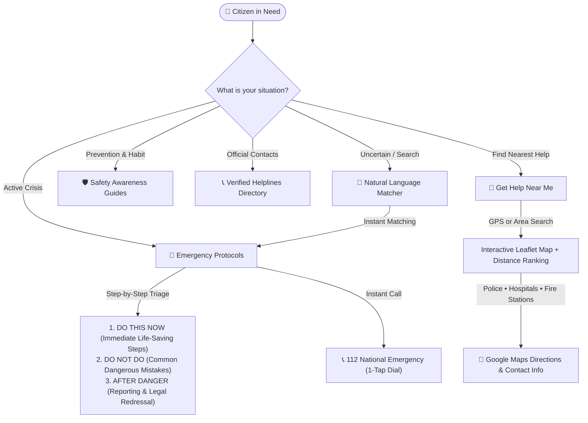
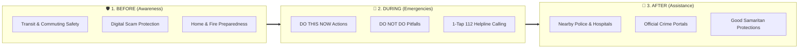
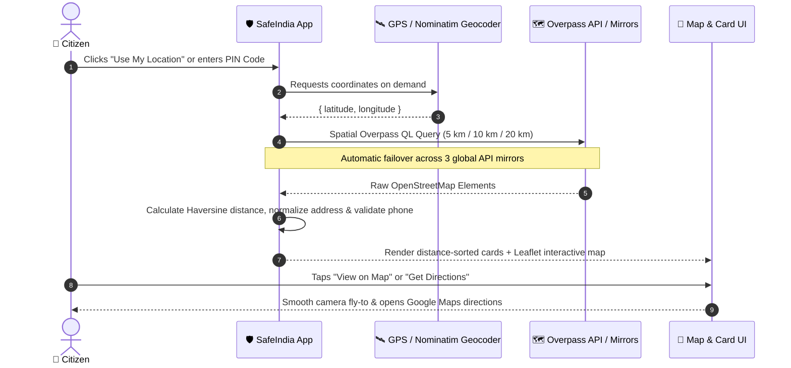
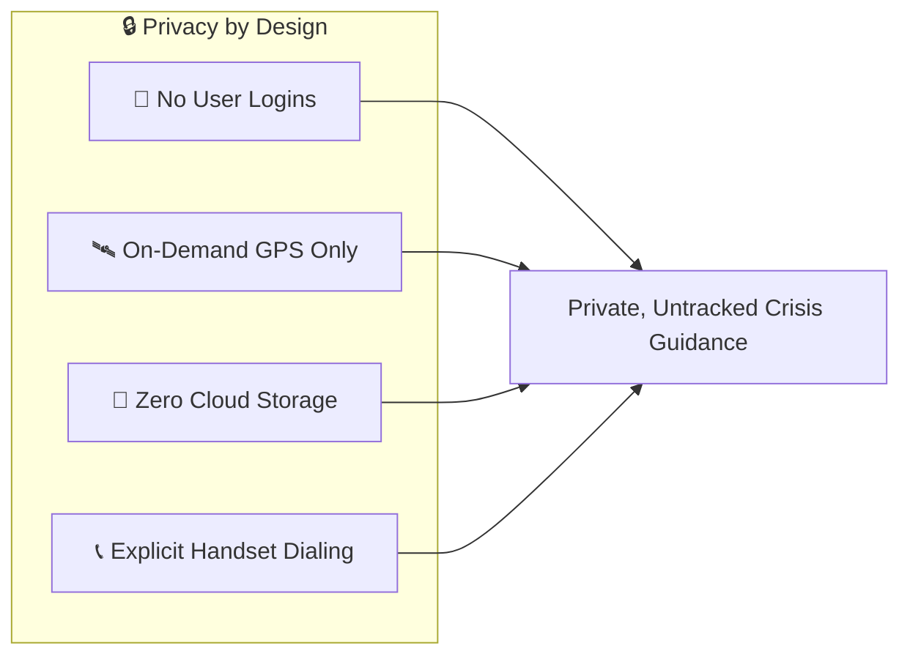

<div align="center">

  

  # SafeIndia
  ### Public Safety & Emergency Companion for India

  **Know what to do when it matters.**

  [](https://react.dev/)
  [](https://www.typescriptlang.org/)
  [](https://vitejs.dev/)
  [](https://tailwindcss.com/)
  [](https://leafletjs.com/)
  [](https://www.openstreetmap.org/)
  [](#privacy--safety-principles)

  <p align="center">
    <a href="#the-mission">The Mission</a> •
    <a href="#how-it-works">How It Works</a> •
    <a href="#core-safety-pillars">Core Pillars</a> •
    <a href="#interactive-facility-discovery">Live Map Discovery</a> •
    <a href="#verified-helplines">Emergency Helplines</a> •
    <a href="#quick-start">Quick Start</a> •
    <a href="#privacy--safety-principles">Privacy & Safety</a>
  </p>

</div>

---

## The Mission

During accidents, cyber scams, medical emergencies, or unsafe transit situations, panic and hesitation cost valuable minutes. People do not need dense legal treatises or confusing menus — they need one immediate answer:

> **"Something has happened. What should I do right now?"**

**SafeIndia** is an open-access public-safety companion built specifically for India. It operates entirely in your browser with **zero logins, zero background tracking, and zero data harvesting**. It pairs verified life-saving protocols with live spatial discovery of nearby police outposts, hospitals, and fire stations across the nation.

---

## How It Works

SafeIndia organizes public safety into an intuitive triage flow. Whether you are facing an active crisis, searching for the nearest emergency service, or learning preventive safety habits, the platform guides you with calm, distraction-free clarity.



---

## Core Safety Pillars

SafeIndia is built on a structured **Before, During, and After** safety framework:



### 1. Emergency Protocols
Actionable, distraction-free steps designed for high-stress moments:
- **Personal Safety**: Harassment, stalking, suspicious transport or cab rides.
- **Medical Crises**: Unconscious patient (CPR basics), severe bleeding, choking, seizures, burns.
- **Fire & Gas Safety**: High-rise fire evacuation, kitchen LPG cylinder leakage.
- **Road & Transit**: Road traffic collisions, bystander assistance under India's Good Samaritan guidelines.
- **Digital & Financial Emergencies**: Unauthorized UPI transfers, OTP scams, stolen smartphone (CEIR IMEI block).
- **Animal Bites**: Snakebites (anti-venom protocol), street dog bites and rabies wound management.

### 2. Live Nearby Help (`Get Help Near Me`)
- **One-Touch GPS**: Discover emergency services within 5 km, 10 km, or 20 km of your current position.
- **Manual Area Search**: Search by any Indian city, town, or 6-digit postal PIN code.
- **Live OpenStreetMap Integration**: Queries verified public police stations, hospitals, clinics, and fire stations.
- **Directions & Navigation**: One-tap directions trigger Google Maps with exact destination coordinates.

### 3. Safety Awareness & Preparedness Guides
- Checklists and preventive routines for daily Indian life:
  - Situational awareness during late-night commutes and metro travel.
  - Digital safety checklists against fraudulent QR codes, fake job offers, and SIM swap attacks.
  - Home fire safety, electrical load safeguards, and gas leak checks.
  - Natural hazard readiness (monsoon floods, earthquake drill, emergency go-bag).

### 4. Verified Directory of National Helplines
- Direct phone triggers and portal links for India’s official emergency networks:
  - **112**: All-in-one National Emergency Response System (Police, Fire, Ambulance, Rescue)
  - **1930**: National Cybercrime Reporting Helpline (Financial Fraud & UPI Scams)
  - **108 / 102**: Free Emergency Medical Ambulance Service
  - **1091 / 181**: Women in Distress 24/7 Helpline
  - **1098**: Childline India
  - **101**: Fire Emergency Services
  - **1906**: LPG Gas Leakage Helpline
  - **14416**: Tele-MANAS Mental Health Support

---

## Interactive Facility Discovery

SafeIndia does not rely on a static, quickly outdated database of facilities. Instead, it queries live spatial data from **OpenStreetMap** with a multi-endpoint failover architecture.



### Data Integrity & Honest Contact Messaging

To ensure users are never misled during a crisis, SafeIndia enforces strict data integrity rules:

| State | What the User Sees | Action Available |
|---|---|---|
| **Valid Phone Available** | Formatted number + `(unverified)` tag | 📞 **1-Tap Call Link** (`tel:...`) |
| **No Phone in Map Data** | *"No phone number listed in map data."* | No broken button; encourages dialing **112** |
| **Malformed Format** | *"Phone number format in map data is uncallable"* | Displays raw text safely without broken links |
| **Complete Address Hierarchy** | Street, Village, Block, District, State & PIN | 🧭 **Direct Navigation Link** to exact coordinates |

> [!NOTE]
> All contact details and facility records originate from OpenStreetMap contributors. SafeIndia clearly identifies crowdsourced records and reminds users to rely on **112 National Emergency** whenever immediate official assistance is required.

---

## Privacy & Safety Principles

SafeIndia is built from the ground up to respect citizen privacy:



- **No User Accounts**: No registration, email collection, or passwords required.
- **On-Demand GPS Only**: Geolocation is requested strictly after an explicit user tap. SafeIndia never runs continuous background location watchers.
- **Zero Coordinate Storage**: Coordinates exist only in browser memory for the active session. They are never transmitted to private servers or stored in cookies.
- **No Third-Party Trackers**: No advertising trackers, behavior analytics, or invasive profiling scripts.
- **Explicit Call Confirmation**: Every emergency call button uses standard `tel:` links that require manual confirmation on your phone. No unauthorized auto-dialing.

---

## Quick Start

### Prerequisites
- **Node.js**: `v18.x` or `v20.x`+ (LTS recommended)
- **npm**: `v9.x`+ (bundled with Node.js)
- **Modern Browser**: Chrome, Firefox, Edge, or Safari with JavaScript enabled

### Installation

```bash
# 1. Clone the repository
git clone https://github.com/ItsShivam05/Safe-India.git
cd Safe-India

# 2. Install dependencies
npm install

# 3. Start local development server
npm run dev
```

Open your browser and navigate to:
```
http://localhost:5173/
```

### Building for Production

```bash
# Type check and build optimized bundle
npm run build

# Preview production build locally
npm run preview
```

> [!TIP]
> SafeIndia does not require any environment variables or API keys. All map tiles, geocoding queries, and spatial discovery endpoints work out of the box using public OpenStreetMap services.

---

## Technology Stack

SafeIndia is powered by a fast, modern frontend stack designed for near-instant load times:

| Category | Tools & Libraries | Purpose |
|---|---|---|
| **Core Framework** | [React 19](https://react.dev/) + [TypeScript](https://www.typescriptlang.org/) | Declarative components, strict types, and robust state management |
| **Build & Tooling** | [Vite](https://vitejs.dev/) + [Oxlint](https://oxc.rs/) | Sub-second HMR, high-speed linting, and optimized production chunking |
| **Styling & Theme** | [Tailwind CSS](https://tailwindcss.com/) | Midnight Plum, Soft Lavender, Sage, and Emergency-Red color system |
| **Interactive Maps** | [Leaflet](https://leafletjs.com/) | Hardware-accelerated maps, custom category markers, and dynamic popups |
| **Spatial Services** | [Overpass API](https://overpass-api.de/) + [Nominatim](https://nominatim.org/) | Real-time queries for nearby amenities and Indian postal code search |
| **Iconography & Motion** | [Lucide React](https://lucide.dev/) + [Framer Motion](https://www.framer.com/motion/) | Accessible SVG icons and smooth micro-interactions |

---

## Emergency Disclaimer

> [!IMPORTANT]
> **SafeIndia is an independent public-safety initiative.** It provides curated guidance based on official Indian guidelines (NDMA, MoRTH, Cyber Crime Portal) and OpenStreetMap spatial data.
>
> In any life-threatening situation, active crime, severe medical crisis, or structural fire, **always dial 112 immediately** on your mobile phone or landline. SafeIndia is a preparation and reference companion, not a substitute for official emergency response services.

---

## Contributing

Contributions to improve protocol accuracy, add regional helplines, or enhance map performance are warmly welcomed!

1. **Fork** the repository on GitHub.
2. **Create a branch**: `git checkout -b feature/clearer-protocol`
3. **Make your changes** and verify code quality:
   ```bash
   npm run lint
   npm run build
   ```
4. **Commit**: `git commit -m "docs: clarify Good Samaritan protections"`
5. **Push & Open a Pull Request**.

---

<div align="center">

  **SafeIndia — Know what to do when it matters.**

  Made with dedication to public safety, digital resilience, and citizen empowerment across India.

</div>
